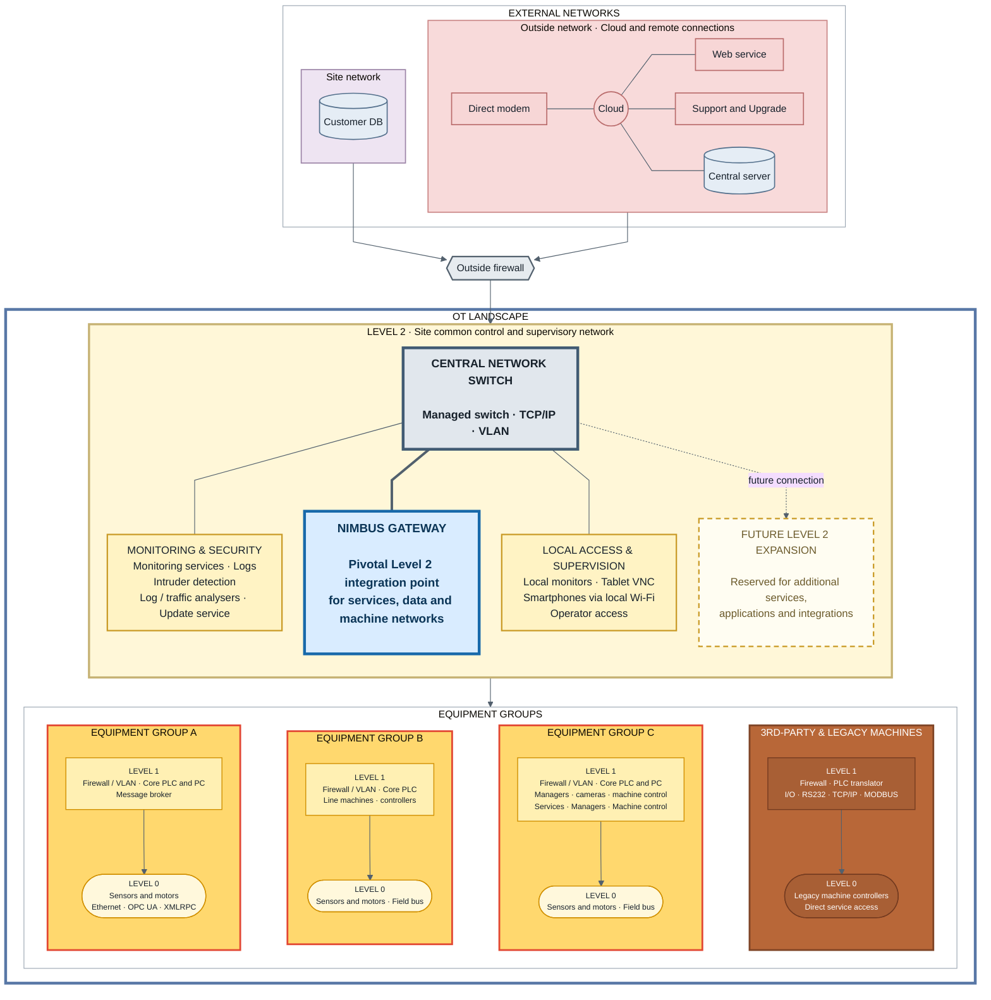

{/* Hidden search synonyms */}

  ot landscape operational technology iec 62443 purdue model zones levels network segmentation plc scada risk assessment
  nimbus gateway

The **OT landscape** describes the operational technology environment of an industrial customer site: the networks, zones, and equipment groups that make up the machine floor and its supporting services.

:::info
The OT landscape is not itself a CRA obligation. It is documented here because the [Risk Assessment](./risk-assessment.mdx) is derived from it — the zones, levels, and connections below define the attack surface and trust boundaries the risk assessment evaluates.
:::

## Reference model

The diagram is intended to follow **IEC 62443-1-1**, using its zone-and-conduit concept and the level structure (Level 0 field devices, Level 1 control, Level 2 supervisory) to segment the environment.
The diagram may not yet be fully compliant with IEC 62443-1-1. It is a living model that is intended to **converge towards compliance** as the OT environment and its documentation mature.

## Landscape diagram

Level 2 is organized around the Nimbus Gateway and includes a reserved growth area. Each Level 1 + Level 0 column is compressed into a two-node summary.

## How the levels map

| Level       | Scope                                | Examples                                                           |
| ----------- | ------------------------------------ | ------------------------------------------------------------------ |
| **Level 2** | Site common control and supervisory  | Central switch, Nimbus Gateway, monitoring, local operator access  |
| **Level 1** | Machine control per equipment group  | Core PLCs and PCs, firewalls/VLANs, machine services               |
| **Level 0** | Field devices                        | Sensors and motors over field bus, OPC UA, Ethernet                |

External networks (site network and outside cloud/remote connections) sit outside the OT boundary and reach the environment only through the **outside firewall**.

## Remote access services

There is (somewhat of) consensus in the CRA working group that a vendor remote-access/connect firewall should be viewed as a "remote access service" rather than as a firewall / security boundary.
The vendor's own network should therefore be considered as part of an outside network.

## Physical access

The CRA working group has no consensus on the classification of physical access to the Ethernet network for the on-site machines.
While Wi-Fi is typically considered a "remote access point" as malicious actors can reach it from outside the building, the Ethernet network is a bit more difficult to classify.
