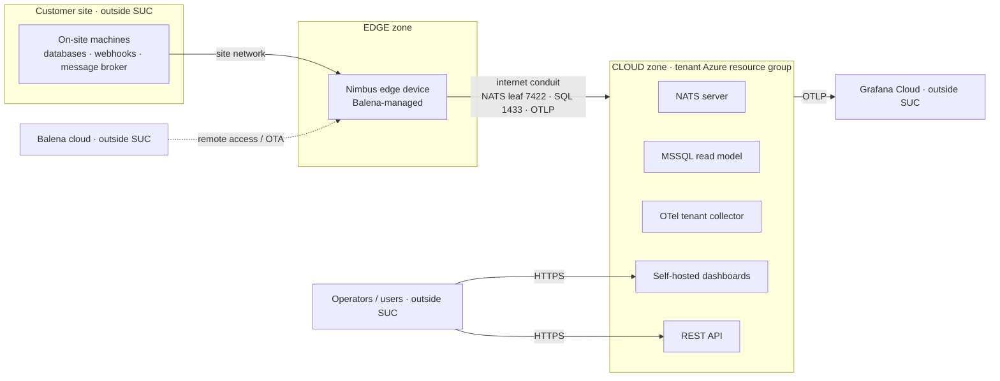

{/* Hidden search synonyms */}

  product context system under consideration suc intended use foreseeable misuse zones conduits access points physical
  perimeter security boundary iec 62443 zcr risk assessment scope

The **product context** describes _what_ we are protecting and _where its boundaries lie_. Under
[IEC 62443-3-2:2020](./01-standards/03-iec-62443-3-2-2020.mdx), this is the first step of the risk assessment
(**ZCR 1 — Identify the system under consideration**): before any threat can be scored, the system, its perimeter,
and its access points must be defined.

:::info
This page defines the **scope** of the [Risk Assessment](./risk-assessment.mdx): the intended use, foreseeable misuse,
security perimeter, and access points of the system under consideration (SUC). The [OT Landscape](./ot-landscape.mdx)
models the wider industrial environment the edge connects to; the SUC itself is narrower — the Nimbus edge device and
its tenant cloud, defined below.
:::

## System under consideration (SUC)

The SUC is the collection of assets that make up a complete solution and that the risk assessment evaluates. Nimbus
is a **data platform, not a machine controller**: it is a Balena-managed **edge device** installed at a customer
site that collects data from the machines already on site, paired with a **tenant-specific cloud** in Azure. The SUC
is those two parts and the connection between them.

Nimbus uses a **tenant-per-site** model — each customer site gets its own Azure resource group (Key Vault,
Container Apps environment, VNet, NATS server, and optional MSSQL read-model database), so each site effectively
has its own cloud.

| Attribute               | Value                                                                       |
| ----------------------- | --------------------------------------------------------------------------- |
| **Name**                | Nimbus edge device + tenant cloud (one customer site)                       |
| **High-level function** | Collect data from on-site machines at the edge and transfer it to a cloud   |
| **Edge**                | Balena-managed x86-64 device running the Nimbus service stack               |
| **Cloud**               | Per-tenant Azure resource group (one per customer site)                     |

The SUC does **not** include the on-site machines themselves (the equipment, its controllers, and PLCs) or the site
network — those are the environment the edge connects to. See the [OT Landscape](./ot-landscape.mdx) for that wider
picture.

## Intended use

Nimbus is intended to:

- Collect data from the machines already on site via the edge device.
- Buffer and transfer that data to the site's tenant cloud over the internet.
- Expose operational insights to operators through self-hosted cloud dashboards and REST APIs.

Intended users and their access are described in [Access points](#access-points) below.

## Reasonably foreseeable misuse

Per the CRA and IEC 62443-3-2, the context must also capture **foreseeable misuse** — non-intended use that a
reasonable person could expect. This section seeds the misuse scenarios that feed the
[Risk Assessment](./risk-assessment.mdx).

The main foreseeable misuse today is a **loss of availability caused by restricting the edge's internet
connectivity**. The customer operates its own network, so its IT can — intentionally or not — block or throttle the
outbound connections the edge depends on (the NATS leaf connection, cloud SQL, and telemetry), which degrades or
stops data collection and transfer. This maps to the IEC 62443 foundational requirement **RA — Resource
availability**.

## Security perimeter and access points

### Security perimeter

The SUC perimeter is **not** a Nimbus-owned firewall — Nimbus does not own the site firewall. The perimeter is
the two things Nimbus operates:

- the **edge device** at the customer site, and
- the **tenant Azure resource group(s)** that make up the cloud system.

Everything else — the on-site machines, the site network, the site firewall, Balena cloud, and Grafana Cloud —
is outside the perimeter and reaches the SUC only through the access points below.

### Access points

An **access point** is any logical or physical point where a data flow crosses the SUC perimeter.

| Access point                       | Side  | Notes                                                                                    |
| ---------------------------------- | ----- | ---------------------------------------------------------------------------------------- |
| Physical access to the edge device | Edge  | Physical access to the device on site (restricted, but not Nimbus-controlled).           |
| Site Ethernet network              | Edge  | The edge is connected to the site network to reach the machines it collects from.        |
| Cockpit database connection        | Edge  | Edge polls an on-site MSSQL database on the site network (port 1433).                     |
| Webhook connection                 | Edge  | Edge receives machine events on a webhook receiver (port 8083).                           |
| Message-broker connection          | Edge  | Edge consumes machine events over the site network via a message broker.                  |
| Balena remote access / deployment  | Edge  | Balena cloud provides OTA deployment and remote access to the edge device.               |
| NATS leaf connection               | Cloud | Edge NATS connects as a leaf node to the cloud NATS public listener (port 7422).         |
| Exposed cloud SQL servers          | Cloud | Tenant MSSQL has public network access enabled (port 1433), restricted by IP firewall.   |
| Self-hosted dashboards             | Cloud | Operator dashboards served from the tenant cloud (see R007 — currently unauthenticated). |
| REST API                           | Cloud | HTTP REST API exposed from the tenant cloud.                                             |
| Remote access to the cloud         | Cloud | Administrative / remote access to the tenant Azure resources.                            |
| OpenTelemetry / Grafana connection | Cloud | Telemetry flows from the cloud (and edge) to Grafana Cloud over OTLP.                     |

:::note
The **open NATS network** discussed in the [Risk Assessment](./risk-assessment.mdx) is an _unintended_ exposure
rather than a designed access point. It is tracked there as a risk; it is noted here only for cross-reference.
:::

## Zones and conduits

The SUC has **two zones**: the **edge** and the **cloud**. The conduit that carries intended traffic between them is
the internet connection over which the edge reaches its tenant cloud (NATS leaf, cloud SQL, and telemetry).

## Physical environment

The **edge device** sits physically at the customer site. Access is **restricted but not controlled by Nimbus** — the
customer governs who can enter the site and reach the device. The **cloud** side has no physical presence for Nimbus;
it runs in Azure data centres managed by the cloud provider.

## Assumptions and external dependencies

- The site network and firewall are operated by the customer, not by Nimbus.
- The edge reaches the tenant cloud only over the outbound connections listed under [Access points](#access-points).
- Azure, Balena cloud and Grafana Cloud are trusted external services outside the SUC.
